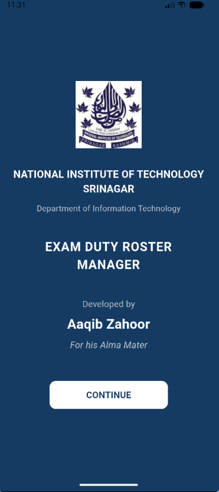
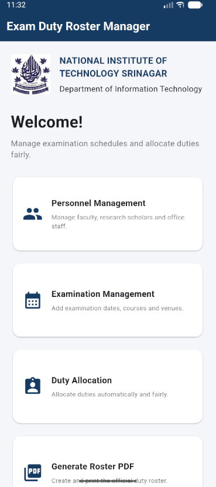
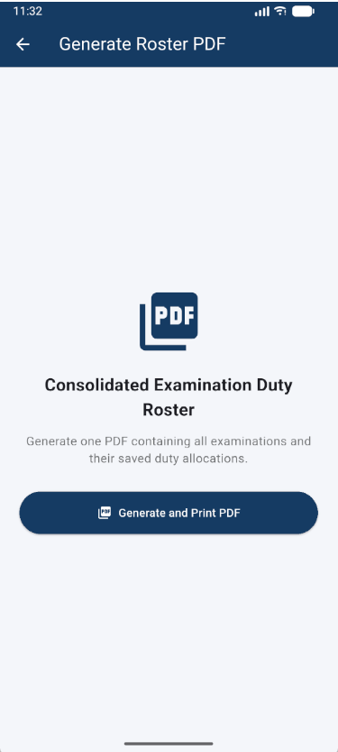
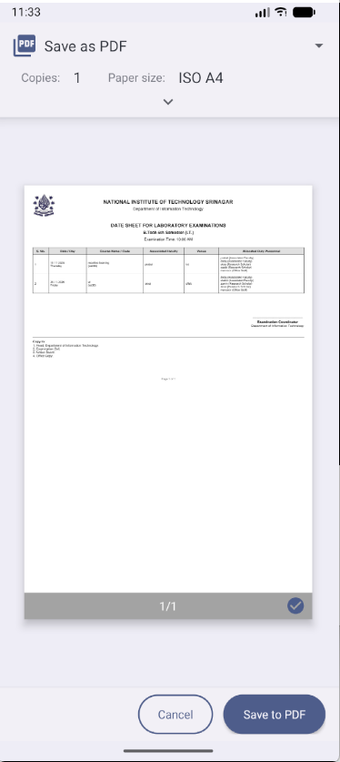

# Exam Duty Roster Manager

A Flutter-based application developed for the **Department of Information Technology, National Institute of Technology Srinagar**, to simplify examination duty management and roster generation.

## About the Project

Exam Duty Roster Manager helps manage departmental personnel, examination schedules, automatic duty allocation, and consolidated PDF duty rosters.

## Features

- **Personnel Management:** Maintain records of Associated Faculty, Research Scholars, and Office Staff.
- **Examination Management:** Add and manage examination dates, course details, associated faculty, and venues.
- **Automatic Duty Allocation:** Allocate five personnel to each examination:
  - 2 Associated Faculty (including the faculty associated with the examination)
  - 2 Research Scholars
  - 1 Office Staff member
- **Fair Allocation:** Prioritise personnel with fewer previous duties and use joining date to resolve ties.
- **Conflict Prevention:** Prevent personnel from being assigned to multiple examinations on the same date.
- **PDF Roster Generation:** Generate a consolidated, printable examination duty roster.

## Download the Android App

**Latest Version: v1.0.0**

[Download Exam Duty Roster Manager APK](https://github.com/AaqibZ/exam-duty-roster-manager/releases/download/v1.0.0/app-release.apk)

For installation, download the APK to your Android device and follow the installation prompts.

[View All Releases](https://github.com/AaqibZ/exam-duty-roster-manager/releases)

## Application Screenshots

### Android App Icon


### Welcome Screen



### Dashboard



### Exam Duty PDF Roster Screen



### Generated PDF Roster



## Technology Stack

- Flutter
- Dart
- SQLite
- PDF and Printing packages

## Project Structure

```text
lib/
├── database/
├── models/
├── screens/
└── main.dart

assets/
└── images/

screenshots/
├── android-icon.png
├── welcome.png
├── dashboard.png
├── duty-roster-screen.png
└── generated-pdf.png
```

## Getting Started

### Prerequisites

- Flutter SDK
- Dart SDK
- Android Studio or Visual Studio Code

### Run the Application

1. Clone this repository:

   ```bash
   git clone https://github.com/AaqibZ/exam-duty-roster-manager.git
   ```

2. Navigate to the project directory:

   ```bash
   cd exam-duty-roster-manager
   ```

3. Install dependencies:

   ```bash
   flutter pub get
   ```

4. Run the application:

   ```bash
   flutter run
   ```

## Developer

**Developed by Aaqib Zahoor**

For his Alma Mater.

**Department of Information Technology**  
**National Institute of Technology Srinagar**

---

*Built with Flutter.*
